# Manual de usuario

> **Historia de usuario:** HU-38 · Sprint 8
> **Objetivo específico:** 3 — Validar el prototipo con los actores culturales y el jurado.
> **Requisitos asociados:** RNF-01 (facilidad de uso).
> **Depende de:** [HU-37 · despliegue de la versión final](36-despliegue-final.md).

**Este documento está escrito para quien va a usar la plataforma, no para quien la
construyó.** Es el único de esta carpeta que no habla de código: aquí no hay ni un nombre de
archivo, ni un selector, ni una decisión técnica. Si buscas eso, está en los treinta y seis
documentos anteriores.

La dirección es **https://hub-cultural-santa-marta.vercel.app** y se abre en cualquier
navegador, en el computador o en el teléfono. No hay nada que descargar ni instalar.

---

## Lo primero: la mitad de esto no necesita cuenta

Buscar actividades, mirarlas en el mapa y ver quién las organiza **no pide registro de
ninguna clase**. La cuenta hace falta solo para una cosa: para publicar lo tuyo.

| Quiero… | ¿Necesito cuenta? |
| --- | --- |
| Ver qué está pasando en Santa Marta | No |
| Buscar por palabra, categoría o fecha | No |
| Ver una actividad en el mapa y cómo llegar | No |
| Contactar a quien la organiza | No |
| **Publicar mis propias actividades** | **Sí** |
| **Aparecer en el directorio de actores** | **Sí** |

Las secciones 1 y 2 de este manual se pueden seguir sin registrarse. De la 3 en adelante
hace falta haber creado la cuenta.

---

## 1. Encontrar lo que está pasando

### 1.1 La portada

Al entrar, lo primero son **cuatro formas de empezar**: Eventos, Actores culturales, Hubs y
Mapa. Si no sabes por dónde, empieza por **Eventos**.

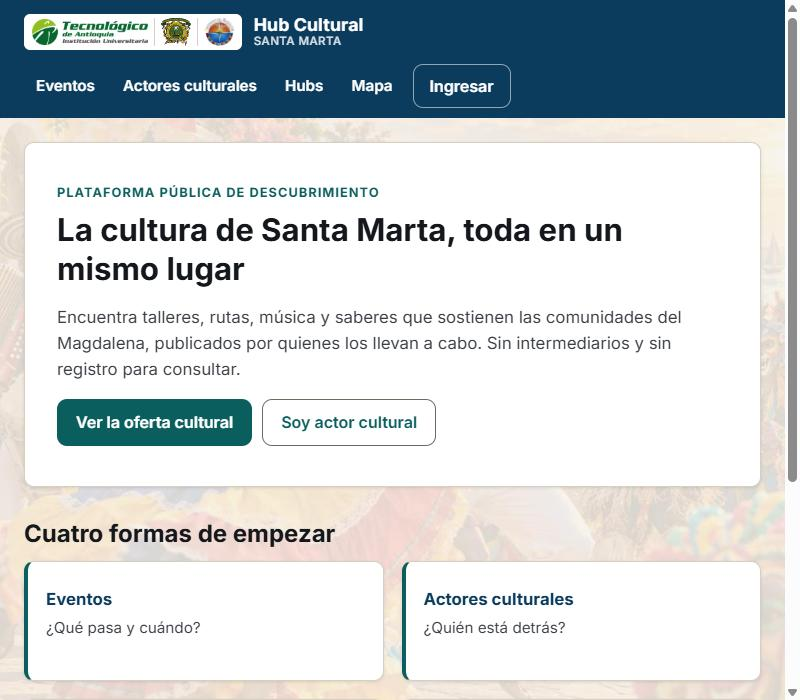

*Figura 1 — La portada. Arriba a la derecha está «Ingresar», que es por donde se entra a una
cuenta; abajo del todo, el pie dice qué versión del sitio estás viendo.*

### 1.2 El catálogo de actividades

**Eventos** lleva al catálogo. Las actividades salen ordenadas por cuál está más cerca de
terminar, así que **lo que ves arriba es lo que antes se te va a pasar**. Lo que ya terminó
no aparece aquí.

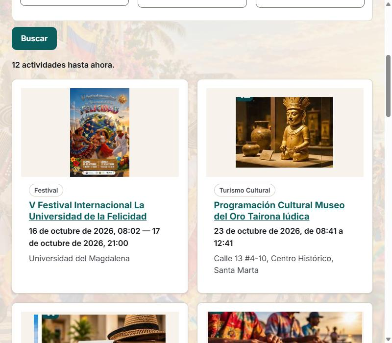

*Figura 2 — El catálogo. Cada tarjeta trae la imagen, la categoría, el título, las fechas y
el lugar. Al pie dice cuántas actividades hay.*

### 1.3 Buscar y afinar

Encima de las tarjetas está **«Busca y afina»**, con cuatro casillas que se pueden combinar:

| Casilla | Para qué sirve |
| --- | --- |
| **Palabra clave** | Busca en el título y en la descripción |
| **Categoría** | Deja solo un tipo de actividad |
| **Desde** | Lo que empiece a partir de esa fecha |
| **Hasta** | Lo que empiece antes de esa fecha |

No hace falta rellenarlas todas: cualquiera funciona sola. Al pulsar **Buscar**, el recuento
de arriba cambia y dice cuántas quedaron de cuántas se miraron —«1 actividad de 13
revisadas»—, y aparece **«Limpiar los filtros»** para volver a verlo todo de un golpe.

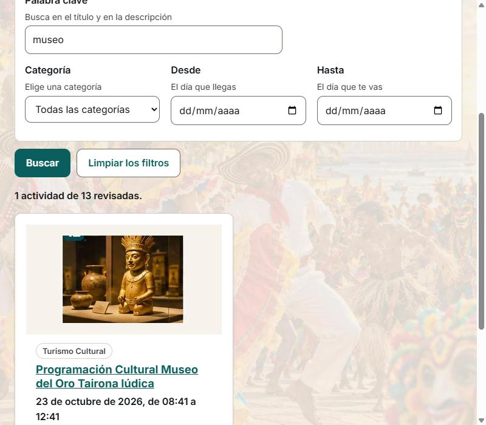

*Figura 3 — Una búsqueda por palabra clave. Si no queda ninguna actividad, el sitio lo dice
con palabras en lugar de dejar la página en blanco.*

### 1.4 La ficha de una actividad

Al pulsar una tarjeta se abre la ficha completa: la imagen entera, de qué va, cuándo es,
dónde es —con su mapa, si quien la publicó la situó—, y **quién la organiza**.

*Figura 4 — La ficha. Debajo de «Quién la organiza» están los botones para escribir o llamar
directamente a quien la hace: no hay intermediario, el mensaje no pasa por la plataforma.*

### 1.5 El mapa

**Mapa** enseña a la vez todo lo que tiene ubicación, con su propio filtro por categoría y el
recuento de cuántas están situadas. Al pulsar un marcador sale un globo con el título y un
botón para abrir la ficha.

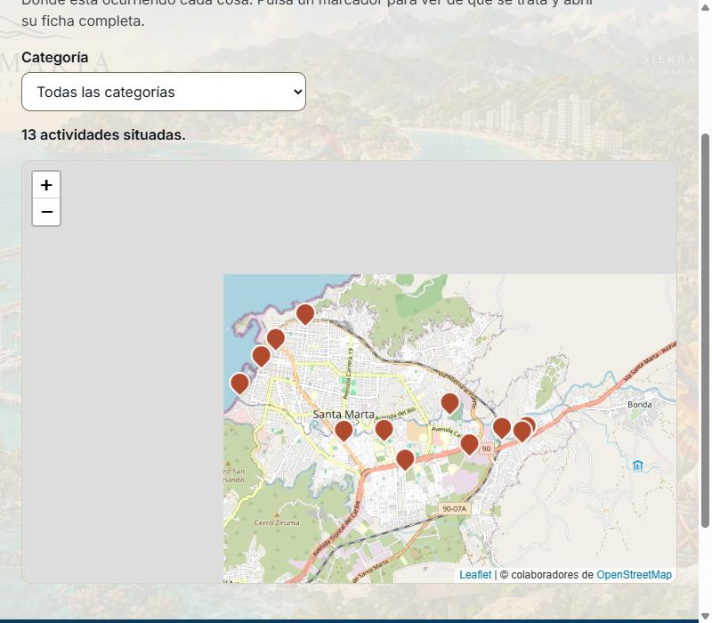

*Figura 5 — El mapa. **En el teléfono, un dedo desplaza la página y hacen falta dos para
mover el mapa**: así no se queda uno atrapado dentro del mapa al bajar por la página.*

### 1.6 Quién está detrás

**Actores culturales** es el directorio de las personas y colectivos que publican. Cada ficha
lleva su manifestación, su descripción y sus actividades.

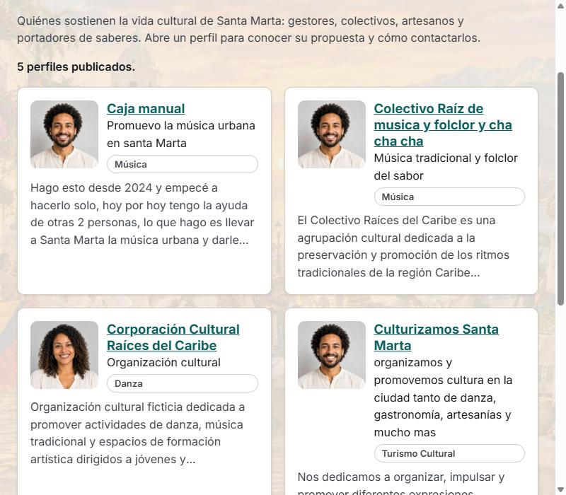

*Figura 6 — El directorio.*

---

## 2. Crear tu cuenta

Solo hace falta para publicar. Si únicamente quieres mirar, puedes saltarte el resto del
manual.

### 2.1 Dónde

Arriba a la derecha, **«Ingresar»**. Esa pantalla tiene dos pestañas: **«Ya tengo cuenta»** y
**«Crear cuenta»**. La segunda es la tuya la primera vez.

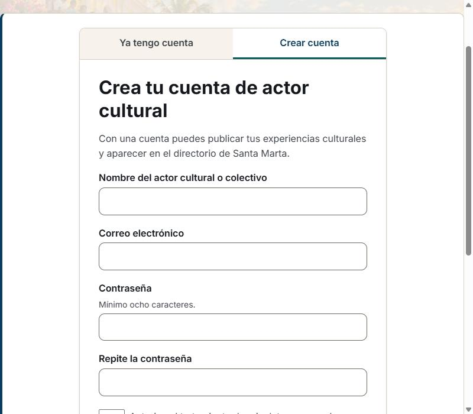

*Figura 7 — Crear cuenta. Son cuatro datos y una casilla.*

| Dato | Qué poner |
| --- | --- |
| **Nombre del actor cultural o colectivo** | Como quieres que te vean. Es lo que aparecerá en el directorio. |
| **Correo electrónico** | Uno al que entres de verdad: por ahí se recupera la contraseña. |
| **Contraseña** | La que vayas a recordar. |
| **Repite la contraseña** | La misma, para que no se cuele un dedazo. |
| **La casilla de abajo** | El permiso para tratar tus datos. Sin marcarla no se puede crear la cuenta, y lo que estás aceptando se puede leer entero en «Tratamiento de datos». |

### 2.2 Si algo está mal, te lo dice antes de enviar

Nada se pierde. El aviso sale **junto al campo que lo causó** y dice qué pasa y qué hacer, no
solo que hay un error.

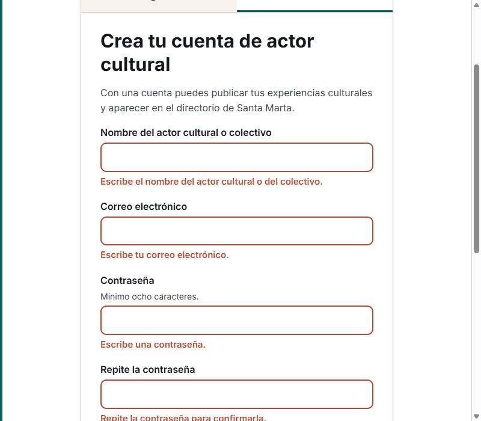

*Figura 8 — Un aviso. Lo que escribiste bien se queda donde está.*

Estos son los avisos tal como están escritos, y lo que significan:

| Si ves… | Es que… |
| --- | --- |
| «Ese correo ya tiene una cuenta en la plataforma. Inicia sesión o recupera tu contraseña.» | Ya te registraste antes. Pasa a «Ya tengo cuenta». |
| «Ese correo no tiene un formato válido. Ejemplo: nombre@dominio.com» | Falta la arroba, el punto o el dominio. |
| «La contraseña es demasiado débil. Usa al menos ocho caracteres.» | Es corta. |
| «Las dos contraseñas no coinciden.» | Se coló un dedazo en una de las dos. |
| «Para crear la cuenta debes aceptar la política de tratamiento de datos personales.» | Falta marcar la casilla. |

### 2.3 Ya estás dentro

Al crear la cuenta entras directamente, sin tener que iniciar sesión aparte. Lo notas en la
barra de arriba: aparece tu nombre y **«Cerrar sesión»** donde antes decía «Ingresar», y con
ellos tres sitios nuevos: **Mi perfil**, **Mis publicaciones** y **Mi hub**.

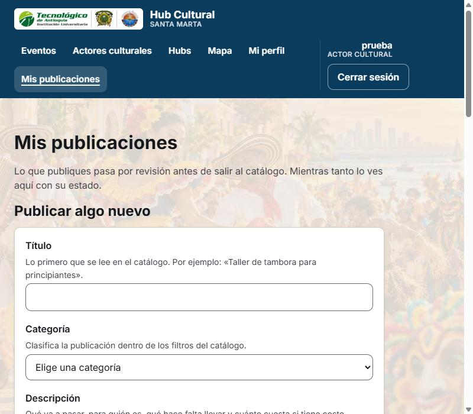

*Figura 9 — La barra con sesión. Si cierras el navegador y vuelves, sigues dentro: no hay que
entrar cada vez.*

> **¿Olvidaste la contraseña?** En «Ya tengo cuenta», «¿Olvidaste tu contraseña?». Escribes
> tu correo y te llega un enlace para poner una nueva. El mensaje que sale es el mismo exista
> o no la cuenta —así nadie puede usar ese formulario para averiguar quién está registrado—,
> de modo que si no te llega nada, revisa el correo no deseado y que lo hayas escrito bien.

---

## 3. Tu perfil de actor cultural

El perfil es lo que la gente ve cuando quiere saber quién organiza algo. **Conviene llenarlo
antes de publicar**, porque tus actividades van a llevar a él.

### 3.1 Los datos

**Mi perfil**, en la barra de arriba. Si ya lo tienes publicado, lo primero que lees es que
lo está, y que **lo que edites aquí se ve al instante sin volver a pasar por aprobación** —el
perfil no se modera, las actividades sí—. Justo debajo hay un enlace para verlo como lo ve
un visitante.

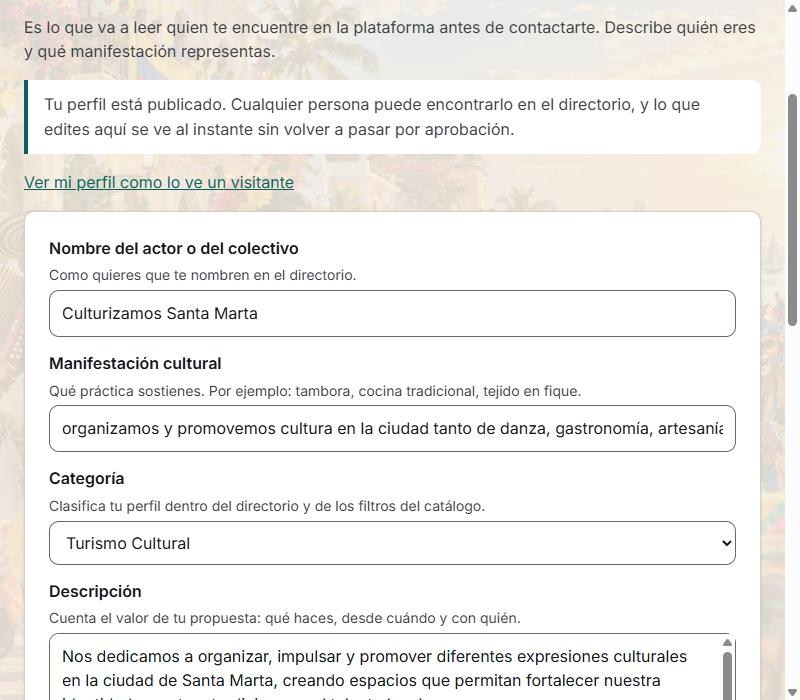

*Figura 10 — Mi perfil.*

| Campo | Qué poner |
| --- | --- |
| **Nombre del actor o del colectivo** | Viene puesto del registro; se puede cambiar. |
| **Manifestación cultural** | En qué andas: danza, música, artesanía, saberes… |
| **Categoría** | La que mejor te describa, de la lista. |
| **Descripción** | Quién eres y qué haces. Es lo que más se lee. |
| **Teléfono, WhatsApp, correo de contacto** | Por dónde quieres que te escriban. |

**Lo que pongas en contacto se va a ver.** Es a propósito —la plataforma conecta sin
intermediarios— pero decide con eso en mente: si prefieres que no te llamen, no pongas el
teléfono.

### 3.2 La imagen

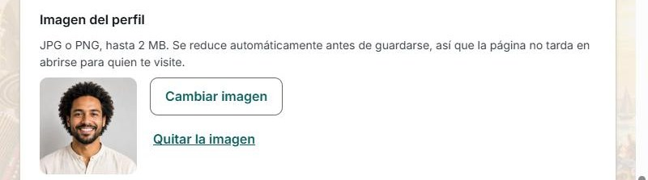

*Figura 11 — La imagen del perfil. La vista previa **es** lo que se va a guardar, no el
archivo que elegiste: si ahí se ve bien, se verá bien.*

- Vale **JPG o PNG**, hasta **2 MB**.
- Se ve una vista previa antes de guardar.
- **Si no pones ninguna no pasa nada**: sale un dibujo con los colores del sitio.
- La imagen se encoge sola al guardarla. Si una foto tuya se ve con poco detalle, vuelve a
  elegirla y guarda: se guardará con más calidad que antes.

Al terminar, **Guardar**. Y para ver el resultado como lo ve cualquiera, el enlace **«Ver mi
perfil como lo ve un visitante»**.

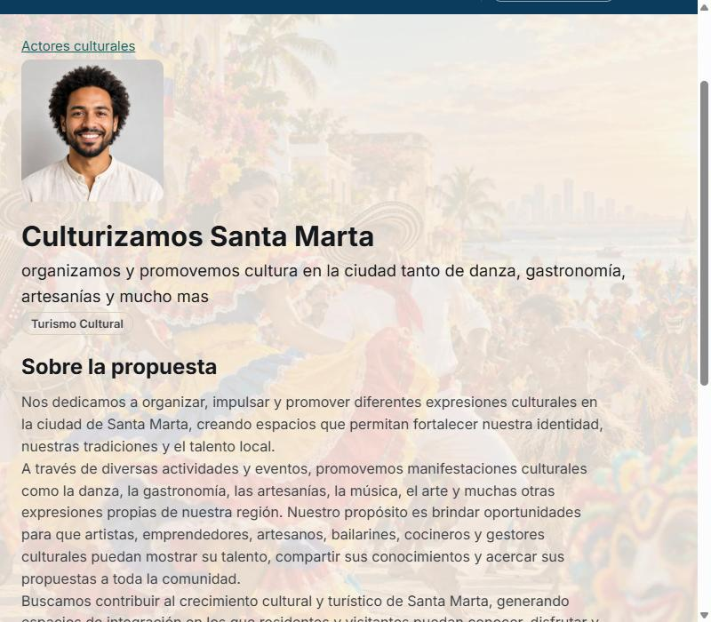

*Figura 12 — La misma información, vista desde fuera. Esto es lo que encuentra quien abre tu
perfil desde el directorio o desde una actividad tuya.*

---

## 4. Publicar una actividad

### 4.1 El formulario

**Mis publicaciones** → **«Publicar algo nuevo»**.

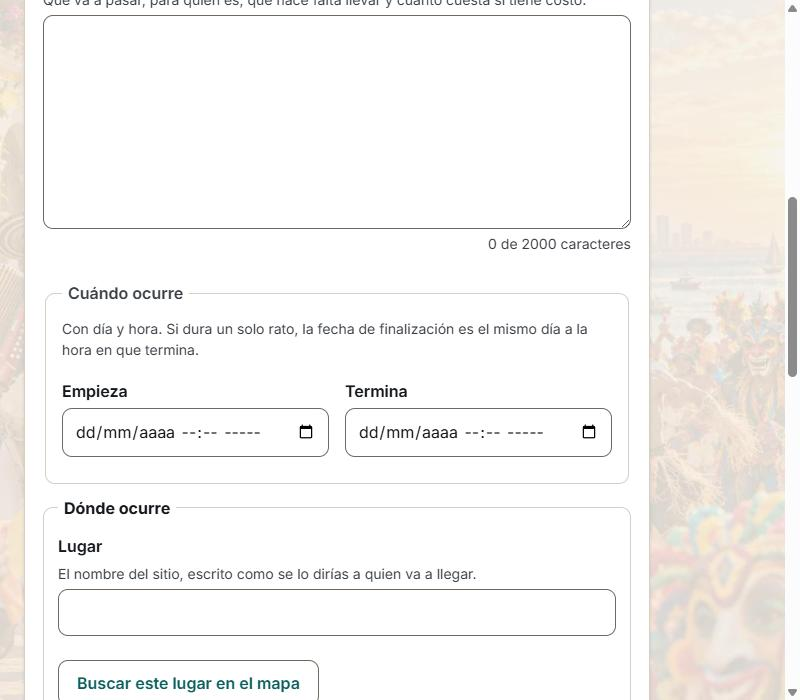

*Figura 13 — Publicar algo nuevo.*

| Campo | Qué poner |
| --- | --- |
| **Título** | El nombre de la actividad, tal como la anuncias. |
| **Categoría** | De la lista. Es por donde la gente va a filtrar. |
| **Descripción** | De qué va, para quién es, qué hay que llevar, si hay que inscribirse. Los saltos de línea se respetan. |
| **Empieza** / **Termina** | Día y hora. Si es de un solo día, la misma fecha en las dos. |
| **Lugar** | El nombre del sitio, escrito como se lo dirías a quien va a llegar. |
| **Imagen de la actividad** | JPG o PNG hasta 2 MB. No es la imagen de tu perfil: es la de esta actividad. |

Debajo de la descripción vas viendo cuántos caracteres llevas de los 2000 que caben.

> **Un consejo que no está en la pantalla.** Mucha gente sube **el cartel** de su actividad, y
> los carteles traen escritas las fechas y las horas. El sitio los muestra **enteros, sin
> recortarlos**, así que esa información se lee. Pero rellena igual las casillas de fecha: son
> las que hacen que tu actividad salga en las búsquedas por fecha, y el cartel no se puede
> buscar.

### 4.2 Ponerla en el mapa

Es **opcional**, y la pantalla te lo dice: *«Todavía no has situado el punto. Sin él la
publicación se guarda igual, pero no aparece en el mapa.»*

Hay dos formas, y se pueden combinar:

1. **«Buscar este lugar en el mapa»**, que usa lo que escribiste en «Lugar».
2. **Pulsar sobre el mapa** para poner el punto, y **arrastrar el marcador** para afinarlo.

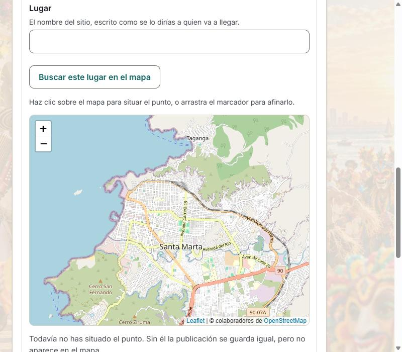

*Figura 14 — El mapa de la publicación. Si la sitúas, tu actividad sale en el mapa general y
su ficha trae un mapa pequeño para llegar.*

### 4.3 Qué pasa después

El botón del final se llama **«Enviar a revisión»**, y dice la verdad: tu actividad **no sale
al catálogo público de inmediato**. Pasa por revisión, y eso es lo que evita que el catálogo
se llene de cosas que no vienen al caso. En «Mis publicaciones» la ves
siempre con su estado:

| Estado | Qué significa | Qué hacer |
| --- | --- | --- |
| **En revisión** | Todavía no aparece en el catálogo público. | Esperar. |
| **Publicada** | Cualquier persona puede encontrarla. | Nada. |
| **Devuelta** | El administrador la devolvió, con observaciones. | Leer las observaciones, corregir y volver a enviar. |

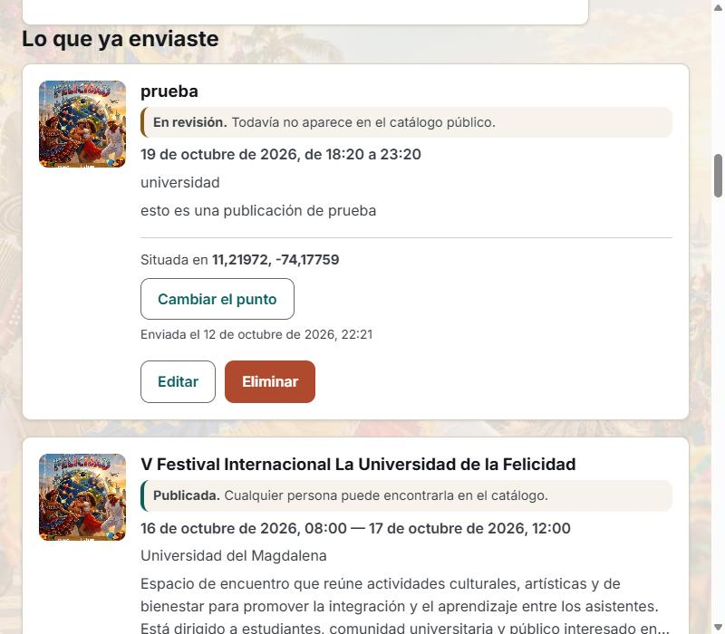

*Figura 15 — Arriba una recién enviada, «En revisión»; debajo una ya «Publicada». Tú las ves
siempre, aunque el público todavía no vea la primera. Cada una dice cuándo la enviaste y, si
la situaste, en qué coordenadas quedó.*

Puedes **editarla, cambiarle el punto del mapa o borrarla** cuando quieras desde la misma
pantalla, también después de publicada. Al editar algo ya publicado vuelve a revisión: es el
precio de que nadie pueda cambiar por detrás lo que ya se aprobó.

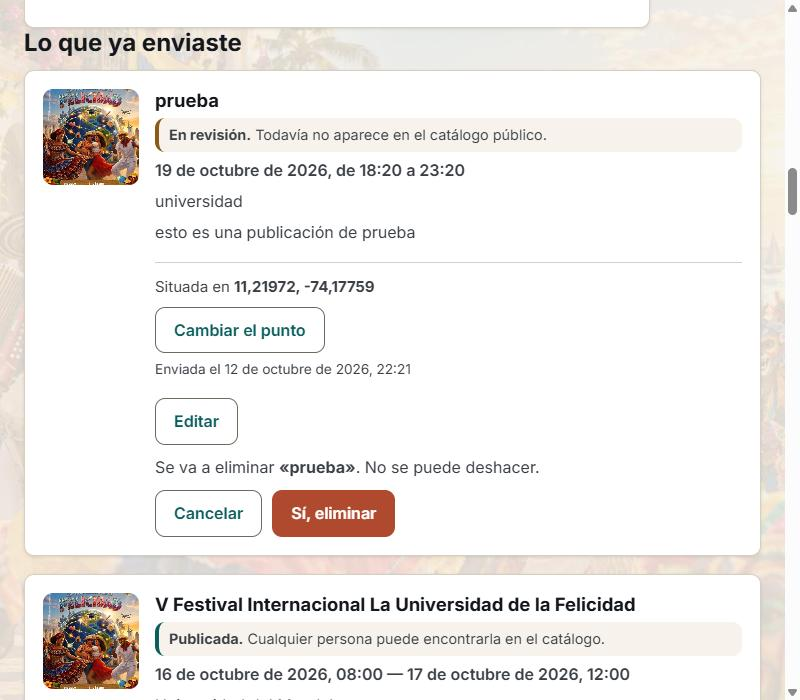

*Figura 16 — Borrar pregunta primero, con el nombre de lo que se va a borrar escrito en la
pregunta: «Se va a eliminar «prueba». No se puede deshacer.» **«Cancelar» está a la
izquierda**, en el sitio donde estaba «Eliminar» cuando lo pulsaste, para que el dedo que iba
rápido no acierte en el botón rojo.*

---

## 5. Lo que más se pregunta

**Publiqué y no la encuentro en el catálogo.**
Mira su estado en «Mis publicaciones». Si dice «En revisión», todavía no está aprobada. Si
dice «Publicada» y aun así no la ves, comprueba que sus fechas no hayan pasado ya: el
catálogo no muestra lo que terminó.

**Me equivoqué en una fecha.**
«Mis publicaciones» → editar. También se pueden corregir las que ya están publicadas.

**Mi foto se ve con poco detalle.**
Vuelve a elegirla y guarda. Las fotos subidas hace tiempo se guardaron más pequeñas de lo que
se guardan ahora, y volver a subirla las pone al día.

**No me llega el correo de recuperar la contraseña.**
Revisa el correo no deseado y comprueba que escribiste la misma dirección con la que te
registraste. El mensaje de la pantalla es el mismo exista o no la cuenta, así que no sirve
para saber si te registraste con ese correo.

**¿Se puede usar desde el teléfono?**
Sí, todo. El menú de arriba se recoge en un botón y las tarjetas se ponen una debajo de otra.

**¿Quién ve mis datos de contacto?**
Cualquiera que entre a tu perfil o a una actividad tuya. Es el funcionamiento buscado: que te
puedan contactar sin intermediarios. Si no quieres que un dato se vea, no lo pongas.

---

## 6. La comprobación con alguien de fuera

El tercer criterio de aceptación de HU-38 no se cumple escribiendo:

> *Dado el manual, cuando se valide con un usuario ajeno al equipo, entonces este debe
> completar las tareas siguiéndolo sin ayuda adicional.*

**Lo decide una persona que no sea del equipo, con el manual delante y sin que nadie le
sople.** Igual que las ocho sesiones de [HU-36](35-usabilidad.md), es de las pocas cosas del
trabajo que no se pueden terminar escribiendo código, y por eso queda aquí el protocolo en
lugar de un resultado inventado.

### Cómo se hace

Una persona, unos veinte minutos, este manual impreso o en otra pantalla. Cuatro tareas, que
son exactamente los cuatro procedimientos que el primer criterio exige cubrir:

| # | Tarea | Secciones |
| --- | --- | --- |
| 1 | Encontrar una actividad de una categoría concreta que ocurra este mes | 1.2 y 1.3 |
| 2 | Crear una cuenta | 2 |
| 3 | Dejar el perfil completo, con imagen | 3 |
| 4 | Publicar una actividad y decir en qué estado quedó | 4 |

Quien acompaña **no ayuda**: solo anota. Lo que se anota de cada tarea es si la terminó, en
cuánto tiempo, y **en qué punto exacto tuvo que preguntar** —porque cada pregunta es un
párrafo de este manual que no estaba claro, y es lo único que hace falta para arreglarlo—.

### Mientras tanto

Los dos primeros criterios **sí** están cumplidos y se pueden comprobar ahora mismo: el
manual cubre los cuatro procedimientos (secciones 1 a 4) y cada uno va con sus capturas
numeradas (figuras 1 a 16).

El tercero queda pendiente, y con él la entrada de HU-38 en la matriz de trazabilidad: como
se explica en [36 §4](36-despliegue-final.md), `npm run verificar:casos` no admite media
historia, porque una sola historia con un caso sin superar bajaría la cobertura por debajo
del umbral y rompería la integración continua de todo el mundo. Los tres casos entran cuando
los tres pasen.

---

## 7. Cierre de HU-38

| Criterio de aceptación | Evidencia |
| --- | --- |
| Cubre registro, perfil, publicación y consulta del catálogo | Secciones 1 a 4: los cuatro procedimientos, cada uno paso a paso. |
| Cada procedimiento con **capturas numeradas** | Figuras 1 a 16, en [`manual/`](manual/). |
| Validado con un usuario **ajeno al equipo** | §6: el protocolo está escrito; **la sesión está por ejecutar**. |

---

*Elaboración propia (2026).*
