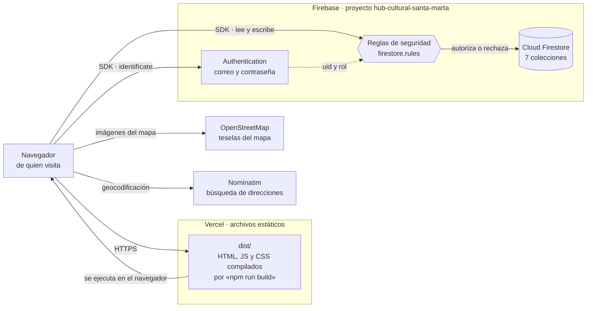

# Documentación técnica

> **Historia de usuario:** HU-39 · Sprint 8
> **Objetivo específico:** 3 — Validar el prototipo con los actores culturales y el jurado.
> **Requisitos asociados:** RNF-09 (mantenibilidad).
> **Depende de:** [HU-37 · despliegue de la versión final](36-despliegue-final.md).

**Este documento está escrito para quien llega de fuera**: alguien que tiene que retomar el
proyecto, auditarlo, o levantarlo entero en otra cuenta sin preguntarle nada a quien lo
construyó. Describe la **versión 1.0.0**, que es la que señala la etiqueta `v1.0.0`.

No repite lo que ya está escrito: los treinta y siete documentos anteriores guardan el porqué
de cada decisión, y aquí se enlaza el que corresponde. Lo que sí hace es ser **completo en
tres cosas** —la arquitectura, el modelo de datos con sus reglas, y el procedimiento para
desplegarlo desde cero—, que es lo que pide la historia.

---

## 1. Qué es esto, en cinco líneas

Una aplicación de página única en **React**, servida como archivos estáticos desde
**Vercel**, que habla directamente con **Firebase** —Authentication y Cloud Firestore— desde
el navegador de cada persona. **No hay servidor propio ni código de servidor**: lo que en
otra arquitectura haría un backend aquí lo hacen las *reglas de seguridad* de Firestore, que
se ejecutan en el servidor de Google en cada lectura y cada escritura.

| | |
| --- | --- |
| Versión descrita | **1.0.0** (`v1.0.0` → `dc45887`) |
| Dirección pública | https://hub-cultural-santa-marta.vercel.app |
| Tamaño | 111 archivos en `src/`, 14 vistas, 7 colecciones, 10 índices |
| Pruebas | **345** unitarias y **221** casos contra las reglas |
| Node | 20 o superior (la integración continua usa 22) |

## 2. Arquitectura

El diagrama por capas, con la responsabilidad de cada una, está en
[03 · arquitectura §1 y §2](03-arquitectura.md). Lo que sigue es el mismo sistema visto **en
ejecución**, que es la vista que hace falta para desplegarlo o para auditar por dónde viajan
los datos:



Tres consecuencias que conviene entender antes de tocar nada:

1. **El cliente es público.** Las seis variables `VITE_FIREBASE_*` acaban dentro del paquete
   que descarga cualquiera, y eso no es un descuido: son identificadores, no secretos. Lo que
   impide que alguien lea o escriba lo que no debe **son las reglas**, no la interfaz.
2. **La interfaz no es la autoridad.** `src/routes/roles.js` decide qué menús se ven y
   `RutaPrivada` qué rutas se abren, pero las dos cosas son comodidad: un tercero puede hablar
   con Firestore sin pasar por la aplicación, y entonces solo quedan las reglas
   ([11 §1](11-reglas-de-seguridad.md)).
3. **Ningún archivo fuera de `src/services/` importa el SDK de Firebase.** Es una regla
   estructural, y `npm run verificar` la comprueba en cada integración.

### Las capas del código

| Carpeta | Qué contiene | Quién la llama |
| --- | --- | --- |
| `src/views/` | Una carpeta por vista, con su `.jsx` y su `.css`. Las 14 están enrutadas. | El enrutador |
| `src/components/` | Lo reutilizable: cabecera, pie, campos, mapas, imagen de actor. | Las vistas |
| `src/services/` | **El único punto de acceso a datos.** Un archivo por colección, más `firebase.js`. | Vistas y componentes |
| `src/hooks/` | Estado reutilizable: sesión, foco, consultas. | Vistas |
| `src/utils/` | Funciones puras: validaciones, fechas, imagen, errores. Es lo que prueba `npm run probar`. | Todo lo demás |
| `src/routes/` | Tabla de rutas, rutas privadas, roles, accesos del inicio, fondos. | La aplicación |
| `src/styles/` | `variables.css` es **la única** que escribe colores. | Todas las hojas |

## 3. Modelo de datos

El detalle campo por campo, con tipos y ejemplos, está en
[04 · modelo de datos](04-modelo-datos.md). El resumen:

| Colección | Contenido | Quién escribe | Quién lee |
| --- | --- | --- | --- |
| `usuarios` | Cuenta y **rol** de cada persona registrada. | El propio usuario y el administrador | El propio usuario y el administrador |
| `actoresCulturales` | Perfil público del actor. | El actor propietario | Público si está aprobado |
| `hubs` | Perfil público del hub de innovación. | El responsable del hub | Público si está aprobado |
| `eventos` | La actividad publicada, con su ubicación y su imagen. | El actor autor y el administrador | Público si está aprobada |
| `categorias` | Catálogo de categorías culturales. | Solo el administrador | Público |
| `moderaciones` | Cada decisión de moderación, con su motivo. | Solo el administrador | El administrador y el actor afectado |
| `interacciones` | Registro anonimizado de consultas y contactos. | Cualquiera, solo crear | Solo el administrador |

**El rol vive en `usuarios`, no en Authentication.** Authentication solo dice quién eres; lo
que puedes hacer sale de leer tu documento de `usuarios` desde las propias reglas. Los roles
son tres —`actor`, `hub`, `administrador`— y hay un cuarto actor sin cuenta: el visitante,
que lee todo lo aprobado y no escribe más que `interacciones`.

### Las imágenes van dentro del documento

No hay Firebase Storage. Cada imagen se reduce en el navegador de quien la sube y viaja como
texto dentro del propio documento de Firestore, con dos límites que conviene no confundir:

| Límite | Valor | Dónde |
| --- | --- | --- |
| Lado mayor de la imagen guardada | **720 px** | `LADO_MAXIMO`, en `src/utils/imagen.js` |
| Tamaño del texto guardado | **120 000 caracteres** | `LIMITE_GUARDADO` y, sobre todo, `firestore.rules` |

El porqué —activar Storage exige plan de facturación y el proyecto no tiene presupuesto
(RNF-10)— está en [03 §6.1](03-arquitectura.md), y lo que cuesta, medido, en
[18 §11 y §12](18-imagen-del-perfil.md).

### Índices

Son **10**, todos en `firestore.indexes.json`, y [04 §10](04-modelo-datos.md) explica uno por
uno qué consulta habilita cada uno —incluidos los cuatro que se declararon y **no** acabaron
usándose, que se documentan igual porque la diferencia entre lo planeado y lo construido es
en sí misma un dato.

> Desde HU-39, `npm run verificar` comprueba que las colecciones con reglas sean exactamente
> las descritas en [04 §1](04-modelo-datos.md) y que el número de índices declarados coincida
> con el de la tabla de §10. Nació de encontrar que este mismo repositorio decía «6 índices»
> cuando ya eran diez, justo debajo de la frase «así que no pueden divergir».

## 4. Desplegar el proyecto desde cero

Lo que sigue levanta el proyecto entero en cuentas nuevas. Tiempo: **una hora larga**, casi
toda esperando a que se construyan los índices y a que Vercel compile.

Hace falta: **Node 20 o superior**, una cuenta de Google, una de GitHub y una de Vercel.

### 4.1 El repositorio

```bash
git clone https://github.com/Petulio14/hub-cultural-santa-marta.git
```

```bash
npm ci
```

`npm ci` y no `npm install`: instala exactamente lo que fija `package-lock.json`.

### 4.2 El proyecto de Firebase

1. En [console.firebase.google.com](https://console.firebase.google.com), **crear proyecto**.
   Google Analytics no hace falta.
2. **Authentication → Comenzar → Correo electrónico/contraseña → Habilitar.**
3. **Firestore Database → Crear base de datos**, en modo producción, región `nam5` o la que
   quede más cerca.
4. **Storage no se habilita.** No se usa, y habilitarlo exige plan de facturación.
5. **Configuración del proyecto → Tus apps → Web**, registrar la aplicación y copiar los seis
   valores del objeto `firebaseConfig`.

### 4.3 Las variables locales

```bash
cp .env.example .env.local
```

Rellena los seis valores. Los seis son obligatorios —incluido
`VITE_FIREBASE_STORAGE_BUCKET`, aunque no se suba ni un archivo—: el arranque los exige todos
y, si falta alguno, la aplicación se levanta igual pero sin Firebase y lo avisa por consola.

```bash
cp .firebaserc.ejemplo .firebaserc
```

Y pon dentro el identificador del proyecto recién creado.

### 4.4 Las reglas y los índices, en este orden

```bash
npm install -g firebase-tools
```

```bash
firebase login
```

```bash
firebase deploy --only firestore:indexes
```

```bash
firebase deploy --only firestore:rules
```

**Primero los índices y después las reglas, y en dos comandos.** La asimetría tiene una razón
sola: un índice de más no le estorba a nadie, y una regla nueva **rechaza** al cliente que
está vivo ([12 §5.1 y §5.2](12-despliegue-continuo.md)). Los índices tardan minutos en
construirse:

```bash
firebase firestore:indexes
```

Si lo que imprime no son los mismos 10 del archivo, el despliegue no terminó. Es barato
comprobarlo y en este proyecto ya hubo una vez en que el catálogo estuvo roto por no hacerlo.

### 4.5 La primera cuenta de administrador

El rol vive en Firestore, así que la primera cuenta se crea a mano una sola vez; el paso a
paso con los campos exactos está en [06 §1.7](06-puesta-en-marcha.md). En resumen:
*Authentication → Añadir usuario*, copiar el **UID**, y crear en `usuarios` un documento
**cuyo identificador sea ese UID** con `rol: "administrador"` y `estado: "activo"`.

Sin ese documento, `soyAdmin()` devuelve falso para todo el mundo y el panel no se abre.

### 4.6 Las categorías

Sin categorías **no se puede publicar nada**: el formulario las exige. Se crean desde el panel
de administración, ya con la sesión del administrador ([16 · categorías](16-categorias.md)).

### 4.7 Vercel

1. **Add New → Project**, importar el repositorio. El preajuste de Vite lo detecta solo;
   `vercel.json` ya fija el comando de compilación, la carpeta `dist/`, la reescritura de
   rutas y las cabeceras de seguridad.
2. **Settings → Environment Variables**: las mismas seis `VITE_FIREBASE_*`.
3. **Deploy.**
4. En Firebase, **Authentication → Settings → Dominios autorizados**, añadir el dominio que
   acaba de dar Vercel. Sin eso, el inicio de sesión funciona en local y falla en el sitio
   publicado.

La reescritura de `vercel.json` manda **toda** dirección a `index.html`. Sin ella, entrar
directamente a `/eventos` —un enlace compartido, un marcador, una recarga— daría 404
([12 §2](12-despliegue-continuo.md)).

### 4.8 Comprobar que quedó bien

```bash
npm run verificar && npm run verificar:casos && npm run probar && npm run build
```

Y sobre el sitio publicado: abrir `/eventos` **directamente** (prueba la reescritura),
comprobar que el pie dice la versión y la compilación, y entrar con la cuenta de
administrador. El contraste entre lo desplegado y la etiqueta se hace como explica
[36 §3](36-despliegue-final.md).

## 5. Las reglas de seguridad aplicadas

Están enteras en `firestore.rules`, en la raíz, y el razonamiento en
[11 · reglas de seguridad](11-reglas-de-seguridad.md). Lo que hacen, colección por colección:

| Colección | Lectura | Escritura |
| --- | --- | --- |
| `usuarios` | El propio documento, o cualquiera si eres administrador | El propio documento al registrarse, y **solo con rol `actor` o `hub`**; nadie se cambia después el rol ni el estado a sí mismo |
| `actoresCulturales` | Pública si `estado == "aprobado"`; la propia siempre | Solo el dueño del `uid`, y no puede aprobarse solo |
| `hubs` | Igual que los actores | Igual que los actores |
| `eventos` | Pública si `estadoPublicacion == "aprobado"`; las propias siempre | El actor autor, que **siempre** deja el estado en `pendiente`; el administrador lo cambia |
| `categorias` | Pública | Solo administrador |
| `moderaciones` | El administrador y el actor afectado | Solo administrador, y exige `observaciones` si devuelve |
| `interacciones` | Solo administrador | Cualquiera, solo `create`, y sin datos del visitante |
| cualquier otra ruta | **denegado** | **denegado** |

Tres cosas que no se ven leyendo la tabla:

- **Nadie puede registrarse como administrador.** La regla de `create` en `usuarios` admite
  `rol` solo entre `actor` y `hub`, y no es un detalle: `soyAdmin()` lee justamente ese
  documento, así que admitir `administrador` ahí habría dejado que cualquiera se diera el
  panel de moderación a sí mismo. Por eso la primera cuenta de administrador se crea desde la
  consola, que no pasa por estas reglas (§4.5).

- **Editar una publicación aprobada la devuelve a `pendiente`**, y no porque el cliente lo
  escriba así, sino porque la regla no acepta otra cosa. Los perfiles de actor, en cambio, se
  editan sin volver a moderación: un evento anuncia una fecha que puede cambiar a algo que no
  debería publicarse; un perfil describe a quien ya fue admitido.
- **La última regla lo deniega todo.** Cualquier colección que alguien cree y que no tenga su
  bloque queda cerrada, que es el comportamiento que se quiere.

### Cómo se comprueban

```bash
npm run probar:reglas
```

Levanta el emulador de Firestore y ejecuta **221 casos** que cubren los 22 criterios de
aceptación que dependen de permisos. Cada prohibición va con el permiso que sí debe
concederse: una regla que lo denegara todo también pasaría las pruebas de denegación, y eso
no demostraría nada.

> **El emulador no arranca en la máquina de desarrollo de este proyecto** —muere al abrir el
> pipe de bucle local— y por eso esas pruebas corren en la integración continua de GitHub
> Actions en cada *pull request* y en cada integración en `master`. Una prueba escrita y nunca
> ejecutada no es evidencia de nada; el flujo es lo que la convierte en evidencia.

`storage.rules` existe y **no está publicado**: Storage nunca se habilitó. Se conserva escrito
por si algún día hay presupuesto.

## 6. Cómo se comprueba que todo sigue en pie

| Comando | Qué comprueba | Dónde corre |
| --- | --- | --- |
| `npm run verificar` | Las cinco reglas estructurales: acceso a datos solo por `src/services/`, toda vista enrutada, colores solo en `variables.css`, toda imagen con texto alternativo, y `docs/04` al día con las reglas y los índices | Local y CI |
| `npm run verificar:casos` | Que ningún criterio de aceptación se quede sin caso y que la cobertura de las historias «Debe» no baje del 90 % | Local y CI |
| `npm run probar` | 345 pruebas de las funciones puras de `src/utils/` | Local y CI |
| `npm run probar:reglas` | 221 casos contra el emulador de Firestore | **Solo CI** |
| `npm run build` | Que la compilación de producción termina | Local y CI |

El flujo está en `.github/workflows/pruebas.yml` y corre los cinco. La rama `master` está
protegida: exige *pull request* con una aprobación y prohíbe reescribir el historial.

## 7. Lo que no hay, y es a propósito

| No hay | Por qué | Dónde se decidió |
| --- | --- | --- |
| Servidor propio | Las reglas de Firestore hacen el control de acceso en el servidor de Google | [03 §6](03-arquitectura.md) |
| Firebase Storage | Exige plan de facturación; las imágenes van dentro del documento | [03 §6.1](03-arquitectura.md) |
| Búsqueda de texto completo | Firestore no la tiene; se filtra en memoria sobre lo ya leído | [04 §11](04-modelo-datos.md), [26](26-busqueda.md) |
| Contador de consultas en `eventos` | Un visitante no puede escribir ahí; se cuentan los registros de `interacciones` | [33 §1](33-indicadores.md) |
| Paginación del catálogo | Doce publicaciones no la piden todavía; está anotado como lo primero que hará falta | [24](24-catalogo-publico.md) |

## 8. Cierre de HU-39

| Criterio de aceptación | Evidencia |
| --- | --- |
| Incluye el **diagrama de arquitectura**, la **estructura de colecciones** y las **reglas aplicadas** | §2 (diagrama de ejecución, y el de capas en [03 §1](03-arquitectura.md)), §3 (las 7 colecciones y los 10 índices) y §5 (qué permite cada regla y cómo se comprueba). |
| Describe el **procedimiento completo para desplegar desde cero** | §4, en ocho pasos, de `git clone` a la comprobación sobre el sitio publicado. |
| El repositorio contiene el archivo **actualizado a la versión final** | Este documento describe la **1.0.0**, y `npm run verificar` falla si las colecciones o los índices dejan de coincidir con lo documentado. |

---

*Elaboración propia (2026).*
